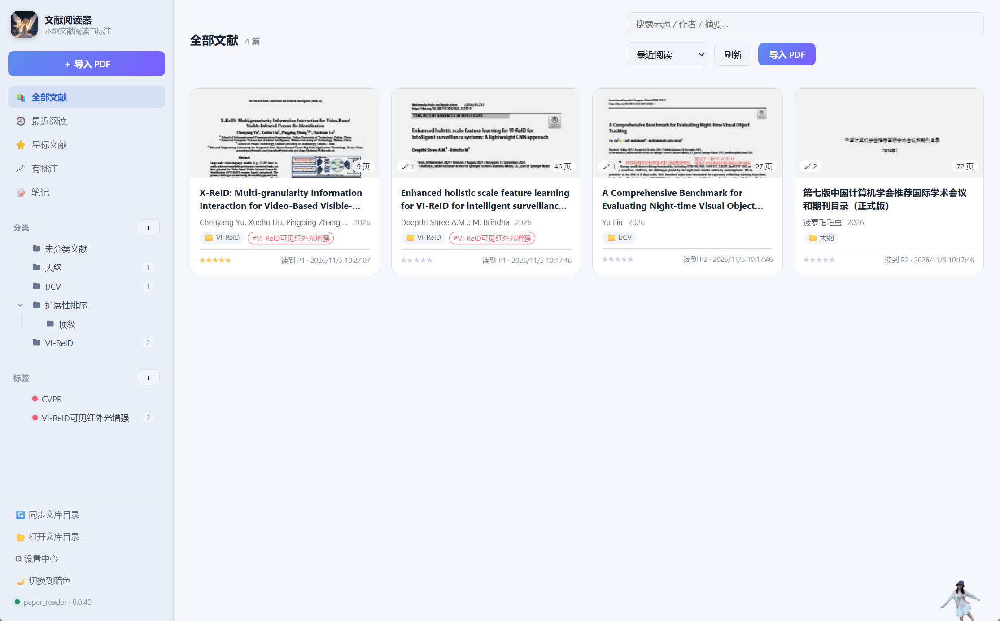
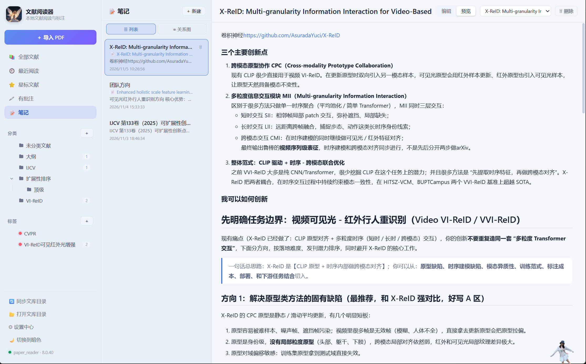
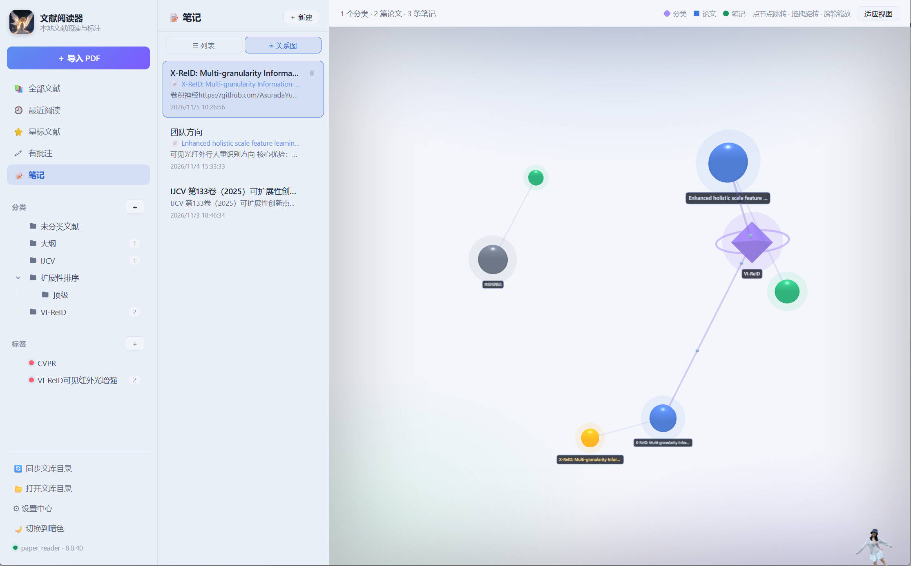

# 文献阅读器

一个跑在本机的 PDF 文献管理器兼阅读器。文献、批注、笔记、阅读记录都存在你自己的 MySQL 里，断网也能用。划词翻译和 AI 理解可以挂本地 GGUF 模型，文本不出机器。

## 直接下载使用（不用装 Node.js）

[](https://github.com/xjdxStudies4zhenl/paperReader/releases/latest)

点上面的按钮进 Releases 页面，下载最新一版的 `文献阅读器-<版本>-win-x64.exe`，双击安装即可：

- 只装到当前用户目录（`%LOCALAPPDATA%`），**不需要管理员权限**
- 安装程序已内置 Electron 运行时、pdfjs 资源，装完直接打开，不用再 `npm install`
- 首次打开填 MySQL 主机、端口、账号、密码，库名默认 `paper_reader`，程序会自己建库建表
- 本地翻译 / AI 模型（约 1GB）按需在应用内下载，跳过也能用

> Releases 页面打不开时，用镜像地址同样能下：
> `https://ghproxy.net/https://github.com/xjdxStudies4zhenl/paperReader/releases/latest`



写它的原因很实际：读完一篇论文，批注在 PDF 里、笔记在别的软件里、它属于哪个分类靠脑子记，过两周就找不着了。这里想把这些搁到一块儿——批注、笔记、分类、以及论文之间的引用关系。

## 怎么跑起来

需要 Windows 10/11、Node.js 20 以上，以及一个能连上的 MySQL 8.x。账号有建库权限就行，表会自己建。

```bash
npm install
npm run build
npm run app
```

仓库里的 `.npmrc` 已经把 registry 和 Electron 二进制都指向 npmmirror 镜像，不用再手动 `npm config set` / `set ELECTRON_MIRROR`。

第一次打开先连数据库：填主机、端口、用户名、密码，库名默认 `paper_reader`，点「保存并初始化」。它会建库（utf8mb4）、执行 `electron/db/schema.sql` 建出 11 张 `pr_*` 表，然后进文献库。连不上的话错误直接显示在弹窗里，多半是密码不对，或者账号不许从 127.0.0.1 登录。

连上之后还会问一次要不要装本地翻译模型（约 1.1GB）。不装照样能用，只是点划词翻译时会提示你去装。安装进度显示在窗口左下角，切页面、关设置都不会丢进度。

不想先开界面、想用命令行建库：

```bash
npm run db:init -- --host=127.0.0.1 --user=root --password=你的密码
npm run db:check -- --user=root --password=你的密码
```

连接信息存在 `%APPDATA%\paper-reader\db-config.json`，密码经 Electron 的 safeStorage 加密，在「设置」里随时改。

## 系统展示

### 文献库

左侧栏从上到下是：全部文献、最近阅读、星标、有批注、笔记；再往下是分类和标签，底部三个按钮管文库目录和设置。

卡片上有批注数、页数、文件大小和星级，点一下进阅读器。右上角搜索覆盖标题、作者、摘要、期刊和 DOI。导入可以用按钮也可以把 PDF 拖进窗口，重复文件按 SHA-256 直接跳过。分类支持把卡片拖过去。

分类不是虚拟的——它对应文库目录里的真实文件夹（`库根/分类名/原文件名.pdf`）。如果你自己在外头把 PDF 拖来拖去、或者往目录里加了新文件，点侧栏的「🔄 同步文库目录」，它会扫一遍：新文件入库、移动/改名的更新路径、软删除的恢复回来，重名重内容的不重复入库。它只读不删，你的文件不会被动。

### 阅读和标注

工具栏里有高亮（红黄橙绿蓝紫，选红色就是标红）、下划线、删除线、框选、手绘、便签，还有一个「选择」工具专门用来选文字做翻译或理解。右侧批注面板按页分组，可以按类型筛、按内容或原文搜，点一条直接跳回那一页；每条批注能改颜色、写正文、追加讨论回复。

阅读器左上角的「☰ 菜单」会把整个左侧栏拉出来，功能跟首页一致。看论文看得卡住了、想顺手去别的分类翻另一篇，不用退出去。

多篇文献是多标签的：来回切不会重新加载，关掉应用再打开，标签还在。

缩放默认 130%，Ctrl+滚轮或按钮都能调；左右方向键、PageUp/PageDown 翻页，页码框可以直接跳到某页。上次读到第几页会记住，下次开就停在那儿。

批注坐标存的是 PDF 用户坐标系（归一化过的 `rects` / `ink_paths`），所以改缩放、换显示器位置都不会跑。

### 笔记和关系图



笔记有两处入口。阅读器右上「📝 笔记」是给当前这篇论文写的，标题默认取论文名，可以改，Markdown 编辑、右边实时预览，停手 0.8 秒自动保存。侧栏「笔记」里是全部笔记，能改每条跟哪篇论文关联，也能删。



关系图是我花时间最多的部分。它按「分类 → 论文 → 笔记」三层摆：紫色八面体是分类，蓝球是论文，绿球是笔记，当前选中的笔记变橙。点分类会跳回文献库并按分类筛，点论文直接开阅读器，点笔记回到列表选中它。拖拽旋转、滚轮缩放，「适应视图」重新把整张图框好。

图是收敛完就停的，不会自己一直抖——之前折腾过一阵子，问题出在笔记编辑器在后台反复触发自动保存，数据每 600ms 变一次，布局就被重启一次。

### 划词翻译、AI 理解

工具栏切到「🌐 划译」，选中文字即弹出浮层，本地模型流式往外吐译文，可以复制，也可以一键存成批注（原文进引用、译文进正文）。

AI 理解走的是另一套：用「选择」工具拖选一段，浮条上点「🧠 理解」，可以选解释、通俗化、提炼要点、翻译加解释、找问题；右上角「🧠 AI 摘要」对整篇做结构化理解，读完还能继续追问。推理默认在本机跑量化模型，也可以在设置里换成 OpenAI、DeepSeek、通义、智谱、OpenRouter、Ollama 或者自建网关。

理解结果能一键存成批注，省得复制粘贴。

### 导出

两种：批注清单 Markdown（按页列出原文引用、批注和讨论回复，能直接丢进 Obsidian 或 Notion），以及标注版 PDF（用 pdf-lib 把高亮、下划线、删除线、框、手绘、便签真画进一份 PDF 副本，正文仍然可选可搜，末尾会附一页批注汇总）。

## 本地模型

翻译和 AI 理解各有一份模型清单，共用同一个模型目录和同一个下载器（HF 国内镜像 → 魔搭 → 官方自动换源，支持断点续传和取消）。文件落在 `%APPDATA%\paper-reader\models\`，也可以指定任意 GGUF。

| 用途 | 模型 | 体积 | 备注 |
| --- | --- | --- | --- |
| 翻译 | Hy-MT2-1.8B Q4_K_M | 1.08GB | 默认，实测约 0.6 秒一句 |
| 翻译 | Hy-MT2-1.8B Q6_K | 1.4GB | 精度高一点，加载慢一点 |
| 理解 | Qwen2.5-3B-Instruct Q4_K_M | 2.0GB | 推荐，质量和速度平衡，显存约 2.6GB |
| 理解 | Qwen2.5-1.5B-Instruct Q4_K_M | 1.06GB | 轻，老笔记本或纯 CPU 选这个 |
| 理解 | Qwen2.5-7B-Instruct Q4_K_M | 4.4GB | 质量最好，建议 6GB 以上显存 |

```bash
npm run model:download            # 翻译模型，默认 Q4_K_M
npm run model:download -- qwen3b  # AI 理解模型
npm run model:download:chat       # 三个理解模型全下
npm run model:download -- --list  # 看清单
```

推理只在两个独立的 UtilityProcess 里跑：`translate-worker.js` 和 `chat-worker.js`，渲染进程碰不到原生模块。崩了会自动重启（最多 5 次），空闲 10 分钟自动卸载释放显存。GPU 后端可以强制指定 cuda / metal / vulkan，初始化失败会降级，并把**实际**用的后端和设备名回显到设置页——我这儿 CUDA 预编译包不兼容的时候显示的就是 `vulkan · RTX 4070`。

启动时会把已装好的模型先预热一遍，期间盖一层进度遮罩，嫌慢可以点「跳过，先进入」。

有个已知问题：Hy-MT2 的 1.25bit 极致量化版（440MB）当前 llama.cpp 解不开，报 `gguf_init_from_reader: tensor 'blk.0.attn_k_norm.weight' has offset ...`。文件本身是全的，缺的是推理后端支持。用 Q4_K_M 就行，等 node-llama-cpp 跟进后在设置里切回去。

## 数据与目录

| 表 | 类型 | 放什么 |
| --- | --- | --- |
| `pr_doc_info` | 主数据 | 文献元数据、文件路径、哈希、缩略图、阅读进度 |
| `pr_folder_info` / `pr_tag_info` | 主数据 | 分类（可自引用成树）、标签 |
| `pr_anno_info` / `pr_bookmark_info` | 主数据 | 批注、页级书签 |
| `pr_note_info` | 主数据 | 笔记（Markdown 原文 + 渲染后的 HTML） |
| `pr_doc_tag_rd` | 记录 | 文献-标签关联 |
| `pr_anno_reply_rd` | 记录 | 批注讨论回复 |
| `pr_read_rd` | 记录 | 阅读会话 |
| `pr_export_rd` | 记录 | 导出记录 |

命名就两条规则：`_info` 是可反复编辑的实体，`_rd` 是一次一条的流水。外键全 `ON DELETE CASCADE`。完整 DDL 在 [`electron/db/schema.sql`](electron/db/schema.sql)。

代码大致这么分：

```
electron/         主进程：窗口、app:// 协议、数据库、IPC、llm/
electron/db/      连接池、建表、schema.sql
electron/ipc/     docs / annos / meta / export / notes / storage / translate / ai
electron/llm/     推理进程与模型管理
src/              React 渲染层：App.jsx、components/、pdf/、styles/
scripts/          建库、自检、演示数据、模型下载
```

## 常用脚本

| 命令 | 作用 |
| --- | --- |
| `npm run build` | 构建渲染层到 `dist/`（顺带复制 pdfjs 的 cmaps 和标准字体） |
| `npm run app` | 启动桌面应用，记得先 build |
| `npm run dist:win` | 只在本机出 Windows 安装包（`release/<版本>/`），不发布 |
| `npm run release:win` | 打包并上传到 GitHub Releases（需 `GH_TOKEN` 环境变量） |
| `npm run db:init` / `db:check` | 命令行建库建表 / 查表和行数 |
| `npm run model:download -- <键>` | 下模型 |
| `npm run llm:check` | 对推理相关文件跑 `node --check` |
| `node scripts/dev-seed.js` | 写一批演示文献、分类、标签和标注 |
| `node scripts/dev-export-test.js` | 不开界面验证两种导出，产物落在 `.smoke/` |

## 常见问题

**连库报 `ER_ACCESS_DENIED_ERROR`**：账号密码不对，或者该账号不允许从 127.0.0.1 登录。MySQL 8 默认的 `caching_sha2_password` 是支持的，不用改回 `mysql_native_password`。

**报 `ER_DBACCESS_DENIED` 建不了库**：给账号 `CREATE` 权限，或者自己先建好库再连。

**中文变成方框**：`dist/pdfjs/cmaps` 没了，重新 `npm run build`。

**本地 AI 太慢、提示显存不够**：7B 建议 6GB 以上显存，不够会自动退到 CPU。可以换 1.5B/3B，或者把上下文从 16K 降到 4K，也可以直接把后端改成 `cpu`。

**模型下载断了**：重新点一次下载，支持续传；命令行等价操作是 `npm run model:download -- qwen3b`。

**换了数据库，老数据没了**：不会自动迁移，这是设计如此。

## 许可

MIT。
